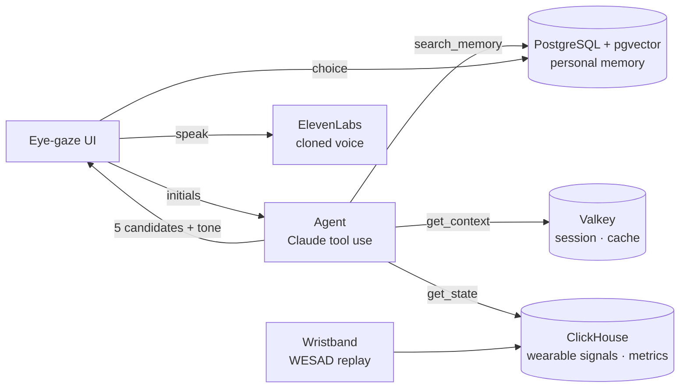

# NeuroVoice

**An AAC agent with memory: a person with ALS types four letters, and NeuroVoice proposes the full sentence they mean — then speaks it in their own voice.**

Built in one day at the **Accel AI Innovate Hackathon** (Paris, October 2026) by María Varela, Pedro and Marc.

**▶ Live demo: [neurovoice.lovable.app](https://neurovoice.lovable.app)**

> People with ALS who communicate with their eyes manage under 10 words per minute. Saying *"my back hurts"* can take 40 glances, and the synthetic voice that reads it out sounds like no one in particular.

## How it works

1. **The user types initials** with eye gaze, e.g. `m d l e`.
2. **An agent** (Claude with tool use) decides what it needs to know: it searches the user's **personal memory** (who visits, what they usually say, routines), reads the **conversation context** (who is in the room, what was just said) and the **wearable state**.
3. It proposes **5 complete sentences**. The user **always chooses** — nothing is spoken without explicit selection.
4. The sentence is spoken with the user's **cloned voice** (ElevenLabs), in a **tone suggested by the wearable** (calm, urgent, annoyed…) that the user can change.
5. Every choice and correction is written back to memory, so suggestions improve with use.



**Why an agent and not a single prompt:** it chooses which memories to retrieve (by initials, by interlocutor, by topic), can search twice, and combines memory, session, state and web. Each tool call is logged, so the reasoning behind every suggestion is visible in the UI.

## Evidence

All numbers come from a **simulation** on a fictional user (Lucas, 58, ALS) with a synthetic corpus: memory = days 1–5, test = days 6–8 (56 sentences), no temporal leakage. Same LLM in every variant; only the data changes.


| Variant | Top-1 | Top-5 | Keystroke savings | p50 latency | Cost / sentence |
|---|---|---|---|---|---|
| LLM, no memory | 12.5 % | 14.3 % | 11.6 % | 3.8 s | $0.0034 |
| LLM + conversation context | 12.5 % | 17.9 % | 25.5 % | 3.6 s | $0.0036 |
| **NeuroVoice (LLM + personal memory)** | **35.7 %** | **42.9 %** | **44.8 %** | **3.0 s** | **$0.0038** |
| NeuroVoice + time & wearable state | 21.4 % | 32.1 % | 42.3 % | 3.5 s | $0.0043 |
| Word-frequency predictive keyboard | — | — | 53.0 % | — | — |

What we learned:
- **Personal memory is what makes it work:** same model, ~3× more sentences right on the first try.
- **A classic word predictor still saves more keystrokes** in this simulation (53 % vs 45 %). NeuroVoice's advantage is getting the *whole sentence* in one selection, which matters for eye-gaze users, where each selection costs 1–2 s. Next step: a hybrid that falls back to word prediction when the sentence misses.
- **Adding time and wearable state to word prediction hurt** (36 % → 21 %). So the wearable sets the *tone of voice*, not the words.

**Wearable state model** (tone suggestion), trained on WESAD wrist data (Empatica E4, 15 subjects), with HR, HRV, EDA and movement normalised per person:

| Task | Balanced accuracy (leave-one-subject-out) |
|---|---|
| Rest vs stress | **95 ± 6 %** |
| Rest vs stress vs amusement | 70 ± 16 % |

Shuffled cross-validation would report 97 % because of temporal leakage between neighbouring windows; we only report LOSO. The state model reuses the signal-processing pipeline from my thesis → [daciu-physio-pipeline](https://github.com/mariavarelacaraballo/daciu-physio-pipeline).


## Design principles

- **The user always decides.** The agent proposes; it never speaks on the user's behalf.
- **Tone is a visible, overridable suggestion.** We don't claim to "read emotions".
- **Traceable.** Every tool call is stored and shown.
- **No clinical alerts**, to stay clear of medical-device territory.
- **No patient data.** Fictional user, synthetic corpus and the public WESAD dataset only.

## Stack

FastAPI · Claude (tool use) · PostgreSQL + pgvector · Valkey · ClickHouse · Aiven Runtime · OpenAI embeddings & transcription · ElevenLabs v3 · Lovable (frontend, separate repo) · Docker

## Run locally

```bash
cp .env.example .env                  # add your own keys
python -m venv .venv && source .venv/bin/activate
pip install -r backend/requirements.txt
python backend/scripts/init_db.py     # create tables
python data/lucas/build_corpus.py     # synthetic corpus for Lucas
python backend/scripts/seed_memory.py # load memory with embeddings
uvicorn backend.app.main:app --reload # http://localhost:8000/docs

python benchmark/run_benchmark.py     # ablation + learning curve → benchmark/results/
```

## Repository

```
backend/app/     FastAPI: agent (prompts, tools, tool-use loop, memory), routes, services
db/              PostgreSQL and ClickHouse schemas
data/lucas/      fictional user: profile, memory, test set
data/estado/     wearable state model (WESAD, LOSO)
benchmark/       ablation, learning curve, tone metric
docs/            architecture, API contract, submission material
```

## Team

| | Role |
|---|---|
| **María Varela** | Agent and backend, benchmark and evaluation, wearable state model |
| **Pedro** | Backend architecture, data layer on Aiven |
| **Marc** | Frontend (Lovable), voice, pitch |

## What's next

Pilot with ALS users through patient associations, a hybrid sentence/word predictor, and integration as a plug-in for existing AAC software (Grid 3, TD Snap).

MIT License.
